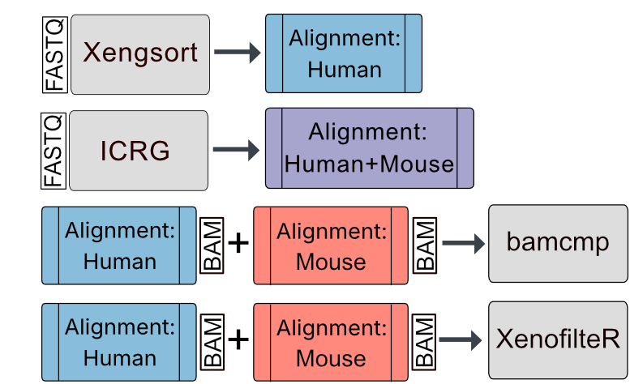

# Runtime & Memory
In this subdirectory, we examined the runtime & max. memory usage of every read sorting workflow.

## Read sorting workflows

  

## Benchmarking

Wall-clock runtime and peak memory usage (`peak_rss`) were evaluated using read mixtures containing **60% human reads** at a sequencing depth of **50 million paired-end reads** across all four mixture datasets.

### Runtime definition

Total runtime was defined as the sum of:

1. **Read sorting execution**
2. **Downstream alignment and BAM processing** performed within the `nf-core/methylseq` workflow:
   - `BWAMETH_ALIGN`
   - `SAMTOOLS_SORT`
   - `SAMTOOLS_INDEX_ALIGNMENTS`

### Tool-specific runtime calculation
Tool-specific (Xengsort, XenofilteR, bamcmp) runtimes and memory usage were collected via LSF accounting while alignment steps were obtained from nextflow reports.
- **bamcmp** and **XenofilteR**  
  Runtime includes **two independent alignments**, one against the human reference genome and one against the mouse reference genome. The total runtime corresponds to the **sum of both alignments and subsequent BAM processing steps**.

- **ICRG strategy**  
  Runtime and memory usage were measured for a **single alignment against a concatenated human–mouse reference genome**, followed by standard BAM processing.

- **Xengsort**  
  Although Xengsort performs **alignment-free read classification**, downstream analysis requires aligned reads. Therefore, reads classified as **human** were subsequently aligned to the human reference genome using the same `nf-core/methylseq` workflow.  
  The reported runtime and memory usage therefore include: Xengsort classification, alignment of human-classified reads and standard BAM processing.

### Memory usage

Peak memory usage was assessed using the `peak_rss` metric reported for each workflow step.  
For every replicate, the **maximum `peak_rss` observed across all executed steps** (read sorting, alignment, and BAM processing) was used as the representative memory usage of the workflow.

In other words, the reported memory value corresponds to the **highest resident memory usage reached by any individual step within the pipeline**, rather than the sum of memory across steps.

### Replicates

Three **technical replicates** were executed per condition.

| Mixture   | Human Ratio | Sequencing Depth | Replicates |
| --------- | ----------- | ---------------- | ---------- |
| Mixture 1 | 60%         | 50M PE reads     | 0–2        |
| Mixture 2 | 60%         | 50M PE reads     | 0–2        |
| Mixture 3 | 60%         | 50M PE reads     | 0–2        |
| Mixture 4 | 60%         | 50M PE reads     | 0–2        |

## Scripts

| Script                                                                             | Usage                                                                                                                           | Requirements                                         | Benchmark                                 |
| ---------------------------------------------------------------------------------- | ------------------------------------------------------------------------------------------------------------------------------- | ---------------------------------------------------- | ----------------------------------------- |
| [06.1_xengsort_array.sh](./06.1_xengsort_array.sh)                                 | Xengsort *.fastq* read sorting (array job)                                                                                      | [xengsort.yml](../environments/xengsort.yml)         | ✓ runtime + memory                        |
| [06.2_methylseq_samplesheets.py](./06.2_methylseq_samplesheets.py)                 | Samplesheet of Xengsort human-sorted reads as input for Methylseq alignment                                                     | [data_science.yml](../environments/data_science.yml) | -                                         |
| [06.3_methylseq_xengsort.sh](./06.3_methylseq_xengsort.sh)                         | Alignment of Xengsort human-sorted reads against the human reference genome                                                     | [nextflow.yml](../environments/nextflow.yml)         | ✓ runtime + memory                        |
| [06.4_methylseq_icrg.sh](./06.4_methylseq_icrg.sh)                                | Alignment of human-mouse mixtures against ICRG                                                                                  | [nextflow.yml](../environments/nextflow.yml)         | ✓ runtime + memory                        |
| [06.5_methylseq_human.sh](./06.5_methylseq_human.sh)                              | Alignment of human-mouse mixtures against the human reference genome; required for bamcmp and XenofilteR read sorting           | [nextflow.yml](../environments/nextflow.yml)         | ✓ runtime + memory                        |
| [06.5_methylseq_mouse.sh](./06.5_methylseq_mouse.sh)                              | Alignment of human-mouse mixtures against the mouse reference genome; required for bamcmp and XenofilteR read sorting           | [nextflow.yml](../environments/nextflow.yml)         | ✓ runtime + memory                        |
| [06.6_bamcmp_bam_sorting.sh](./06.6_bamcmp_bam_sorting.sh)                        | Name-sorted *.bam* files required for bamcmp input                                                                              | [bamcmp.yml](../environments/bamcmp.yml)             | -                                         |
| [06.7_bamcmp_array.sh](./06.7_bamcmp_array.sh)                                    | bamcmp read sorting (array job)                                                                                                 | [bamcmp.yml](../environments/bamcmp.yml)             | ✓ runtime + memory                        |
| [06.8_xenofilter_samplesheet.R](./06.8_xenofilter_samplesheet.R)                  | Create samplesheet as input for XenofilteR                                                                                      | [xenofilter.yml](../environments/xenofilter.yml)     | -                                         |
| [06.9_xenofilter_bam_sorting.sh](./06.9_xenofilter_bam_sorting.sh)              | Coordinate-sorted *.bam* files required for XenofilteR input                                                                    | [xenofilter.yml](../environments/xenofilter.yml)     | -                                         |
| [06.10_xenofilter_array.R](./06.10_xenofilter_array.R)                            | XenofilteR read sorting (array job)                                                                                             | [xenofilter.yml](../environments/xenofilter.yml)     | ✓ runtime + memory                        |
| [06.11_runtime_memory.ipynb](./06.11_runtime_memory.ipynb)                        | Extract nextflow alignment pipeline traces and compute runtime + memory statistics                                              | [data_science.yml](../environments/data_science.yml) | Extracts runtime + memory from alignments |
