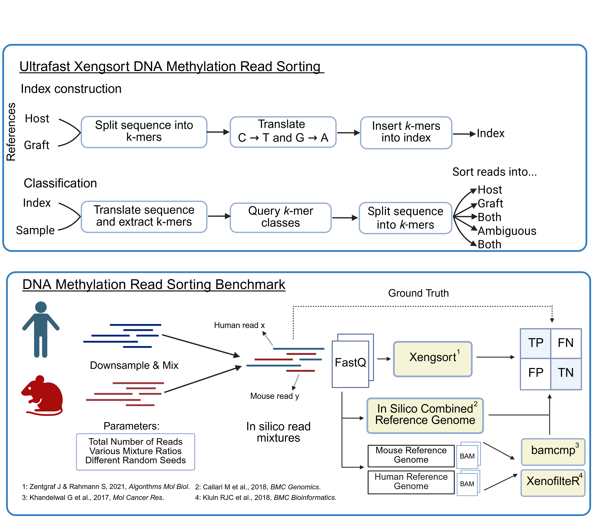

# High-performance xenograft read sorting for DNA methylation analysis
This repository contains the code and methodology used to benchmark read sorting algorithms for cytosine-converted reads.

## Abstract
Patient-derived xenograft (PDX) models are used in cancer research to study tumor progression and drug resistance in vivo [1]. DNA methylation (DNAm) profiling of PDX models reveals tumor adaptation under therapy [2], but its analysis is complicated by host contamination. Cytosine conversion-based sequencing methods (using bisulfite or enzymatic conversion) further complicate this task by reducing sequence complexity and altering nucleotide composition.  Xengsort [3] is an alignment-free tool that classifies xenograft-derived sequencing reads into five classes (clearly host/graft; both; neither; ambiguous) by querying the associated species for the gapped k-mers contained in each read. For this, Xengsort uses a three-way bucketed Cuckoo hash table with several engineered implementation tricks that make both construction and lookup very fast (e.g., lock-free parallelization via subtables; software prefetching of soon needed buckets) and reduce memory usage (quotienting).
In this work, we adapt Xengsort to (bisulfite or enzymatically) converted DNA sequencing data for methylation analyses and benchmark its performance against alternative approaches. The adapted algorithm supports reduced alphabets and processing reads under both C→T and G→A transformations (Fig.1A). 
To benchmark Xengsort against alternative read-sorting approaches, we selected alignment to an in silico combined reference genome (ICRG) and dual-alignment approaches (bamcmp and XenofilteR) as additional methods (Fig.1B). We validated the performance of Xengsort on published real PDX datasets. Xengsort supports both single-end and paired-end data, typically with higher classification in category “both” for single-end data, as may be expected.
All methods classify accurately, considering the fraction of kept contaminating non-human reads (false positives) and discarded human reads (false negatives), with slightly higher human read loss by XenofilteR. In contrast, scalability differed markedly: Xengsort achieved the fastest runtime and lowest memory usage by performing classification at the FASTQ level and further processing only human-classified reads.  These efficiency gains became even more pronounced for Whole Genome Bisulfite Sequencing (WGBS), Reduced Representation Bisulfite Sequencing (RRBS) and Enzymatic Methylation Sequencing (RREMS) breast cancer PDX datasets (GSE237768, GSE152202, GSE186747).
In summary, the adapted Xengsort enables accurate, conversion-aware read sorting in both simulated and real xenograft datasets. It markedly outperforms other read-sorting methods in scalability and flexibility due to its alignment-free design, providing a robust solution for DNAm analysis in PDX studies.

**Fig. 1:** **(A)** Xengsort index and classification step with alphabet conversion for methylation analysis. **(B)** Overview of benchmark procedure.

**References:** \
[1] Blanchard Z, Brown EA, Ghazaryan A, Welm AL. PDX models for functional precision oncology and discovery science. Nat Rev Cancer 25, 153-166 (2025). \
[2] Romero-Garcia S, Prado-Garcia H, Carlos-Reyes A. Role of DNA Methylation in the resistance to therapy in solid tumors. Front Oncol. 10, 1152 (2020). \
[3] Zentgraf J, Rahmann S. 2021. Fast lightweight accurate xenograft sorting. Algorithms Mol Biol 16, 2 (2021).

## Methods & Scripts

| Category | Folder | Description |
|----------|--------|-------------|
| In Silico Benchmark | [01_preprocessing](./01_preprocessing/) | Adapter trimming and quality control (TrimGalore!), and construction of in silico human-mouse read mixtures |
| In Silico Benchmark | [02_alignment](./02_alignment/) | Bisulfite-aware alignment (nf-core/methylseq, bwameth) of mixtures against the human and mouse reference genomes, required for bamcmp and XenofilteR |
| In Silico Benchmark | [03_read_sorting](./03_read_sorting/) | Run Xengsort, bamcmp, and XenofilteR read sorting on the simulated mixtures |
| In Silico Benchmark | [04_icrg](./04_icrg/) | ICRG strategy: competitive alignment against a concatenated human-mouse reference genome |
| In Silico Benchmark | [05_evaluation](./05_evaluation/) | Evaluate and parse read sorting outputs from all four methods into common metrics |
| In Silico Benchmark | [06_runtime_memory](./06_runtime_memory/) | Benchmark runtime and peak memory usage across all read-sorting and alignment workflows |
| In Silico Benchmark | [07_visualization](./07_visualization/) | Compare performance and scalability metrics across methods and produce summary visualizations |
| PDX Validation | [08_pdx_wgbs](./08_pdx_wgbs/) | Validate Xengsort on real WGBS PDX data (Achinger-Kawecka 2024) |
| PDX Validation | [09_pdx_rrems_rrbs](./09_pdx_rrems_rrbs/) | Validate Xengsort on real RRBS and RREM-seq PDX data (Guillen 2022) |

Each folder contains its own README with detailed script usage. Shared conda environments are in [environments/](./environments/), and shared Python helper functions used across notebooks are in [helper/](./helper/).
